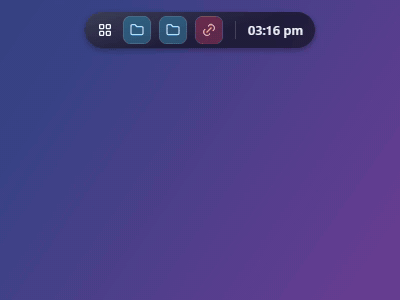

# Floaty

A lightweight, Mac-style floating island for the Windows desktop. It sits on your screen as a small pill, expands into a card of quick-access items, and gets out of the way when you are done.

Built with Rust + [Tauri 2](https://tauri.app) (WebView2) and a tiny vanilla JS/CSS UI. No bundler, no framework. The release exe is about 3.7 MB.



## Features

**Island**
- Collapsed pill and expanded card with a smooth morph between them
- Docks to 8 positions: top, bottom, left, right and the four corners (vertical pill on side docks)
- Always on top, hides over fullscreen apps, optional auto-hide
- Click outside to collapse; clicks around the island pass through to the desktop
- Choose the screen: Screen 1, Screen 2 or all screens
- Global hotkey (`Alt+Space`) and tray icon

**Quick access**
- Drag and drop files, folders, apps (exe), text files and URLs onto the island
- Groups, search, drag to reorder, running-app indicator
- Pin items to show in the collapsed pill
- Right-click an item to set its color and icon
- Import apps from the Start Menu
- Profiles (separate item sets)

**Widgets**
- Clock, battery, now playing (media controls), clipboard history, timer

**Look**
- Themes: glass, dark, light, solid, follow system (including accent color)
- Opacity, accent color, grid rows that grow up to a configurable maximum
- Start with Windows, config export / import

## Install

Download `Floaty_x.y.z_x64-setup.exe` (per-user NSIS installer, no admin rights needed) or build it yourself, see below.
Requires Windows 10/11 with the WebView2 runtime (already present on Windows 11).

Config lives in `%APPDATA%\com.floaty.app\config.json`.

## Build

Prerequisites: [Rust](https://rustup.rs) (MSVC toolchain) and Node.js (only to run the Tauri CLI).

```sh
cd src-tauri

# run a debug build
cargo run

# release exe: src-tauri/target/release/floaty.exe
cargo build --release

# installer: src-tauri/target/release/bundle/nsis/
npx @tauri-apps/cli@2 build --bundles nsis
```

## Project layout

```
ui/                 static front end (index.html, app.js, style.css, icons.js)
src-tauri/src/      Rust back end: docking, windows, tray, launching, media, config
src-tauri/tauri.conf.json
ui-reference.html   the visual reference the UI was styled after
```

## Notes

- Windows only.
- The window is a fixed transparent canvas that is clipped to the island; it never resizes while the island morphs, which avoids flicker on WebView2.
- Icons are a bundled subset of [Tabler Icons](https://tabler.io/icons) (MIT).
